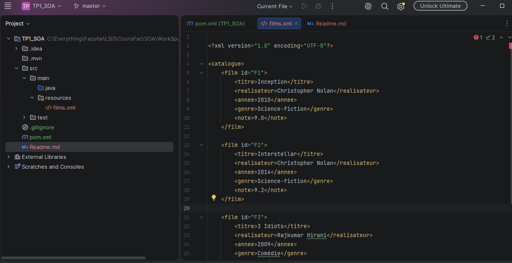
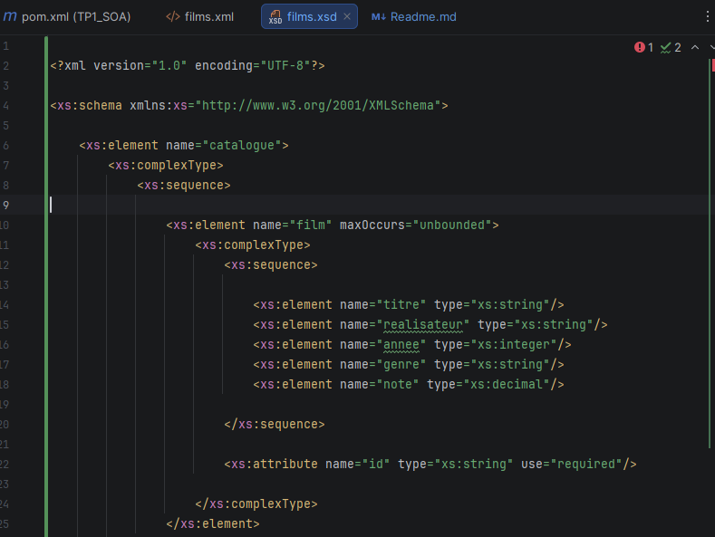
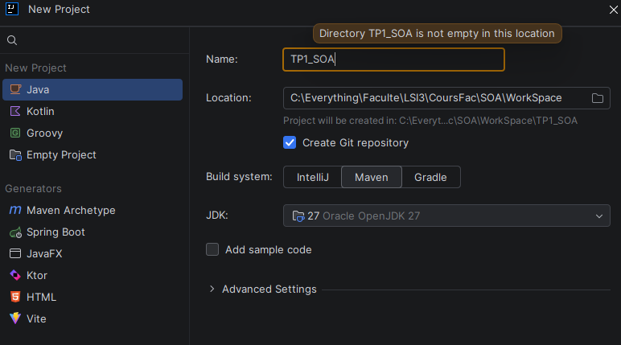
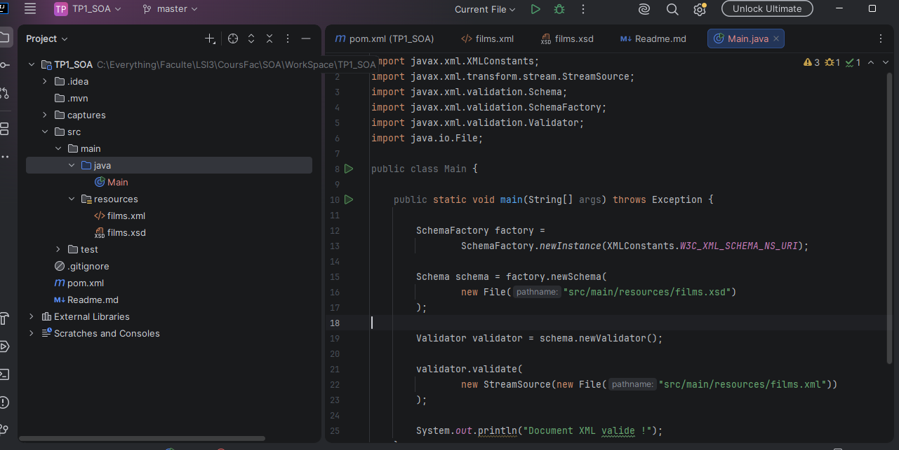

# TP1 – Modélisation XML et interrogation XPath avec Maven en Java

### Étape 1 – Choix du domaine et modélisation XML

Choix d'un domaine réel, identification des entités principales et création d'un fichier XML pour représenter les données de manière structurée.

### Étape 2 – Création du schéma XSD

Création d'un fichier XSD permettant de définir la structure et les règles de validation du document XML.

### Étape 3 – Création du projet Maven

Création d'un projet Maven sous IntelliJ IDEA et ajout des dépendances nécessaires dans le fichier `pom.xml`.

### Étape 4 – Implémentation de la validation XML/XSD

Utilisation de `SchemaFactory` et `Validator` en Java pour vérifier la conformité du document XML par rapport au schéma XSD.
